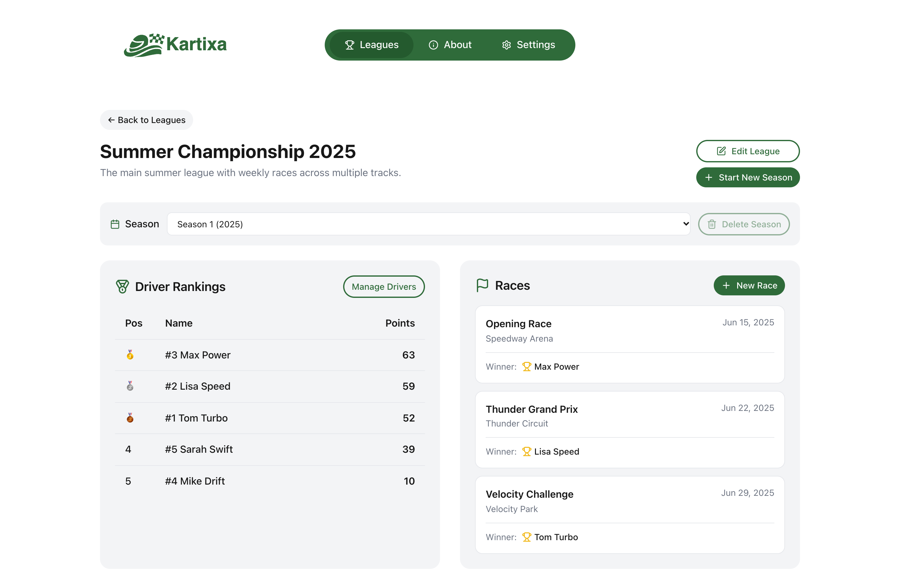
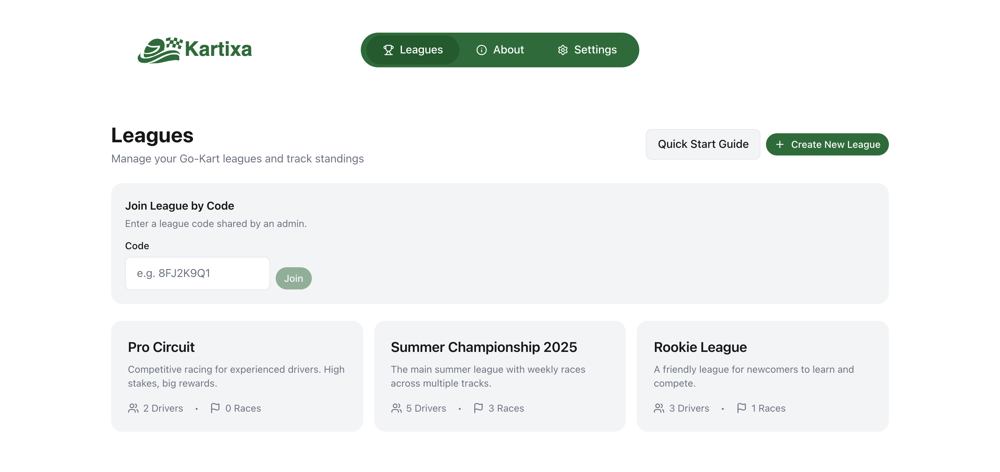
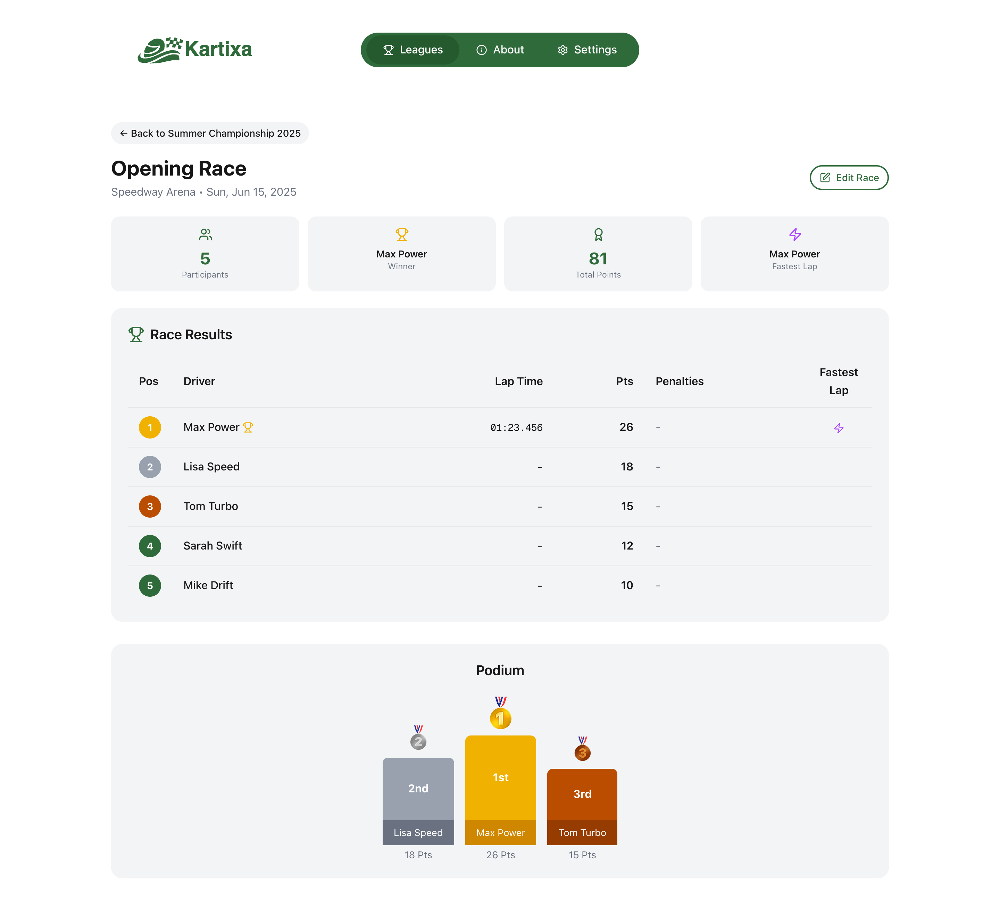
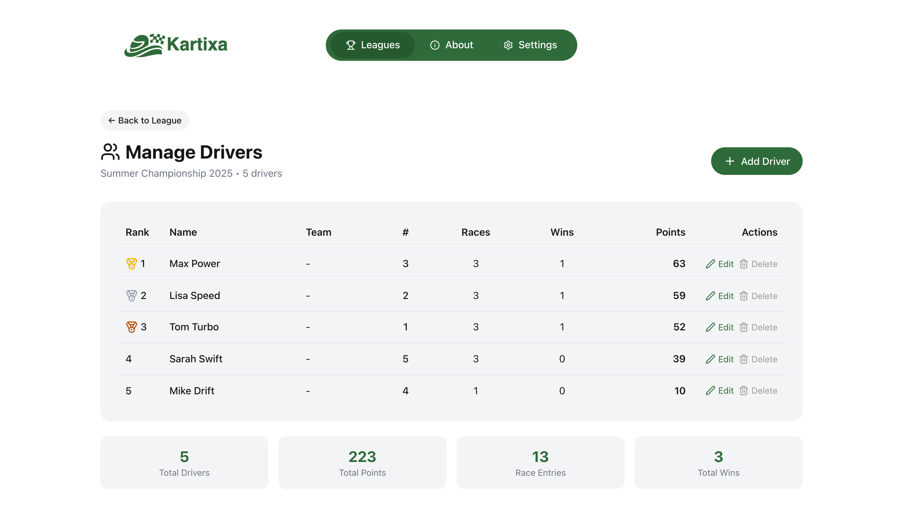
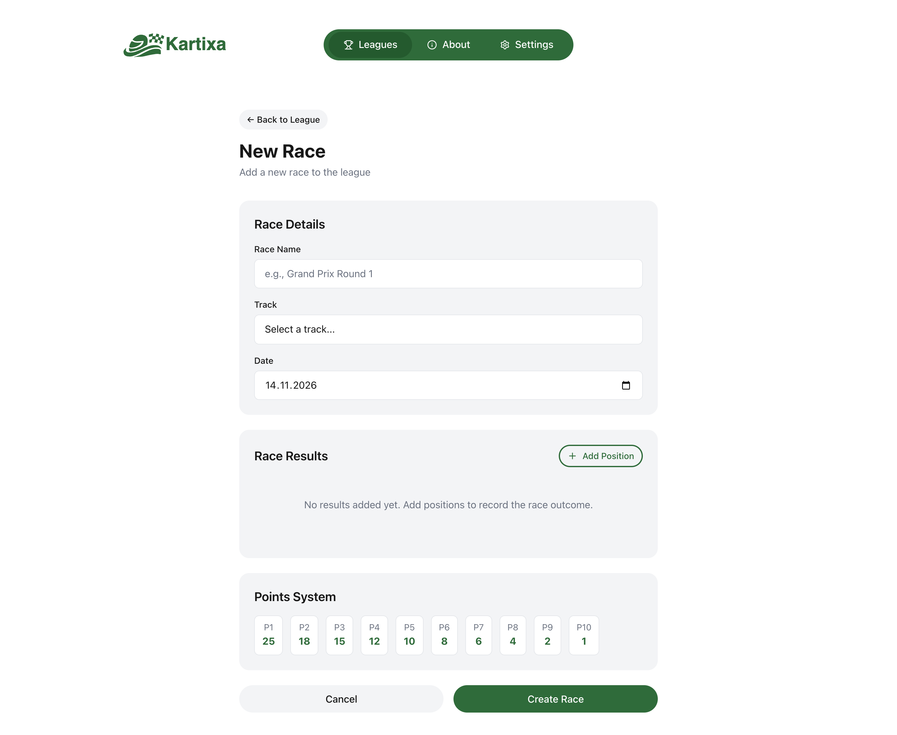
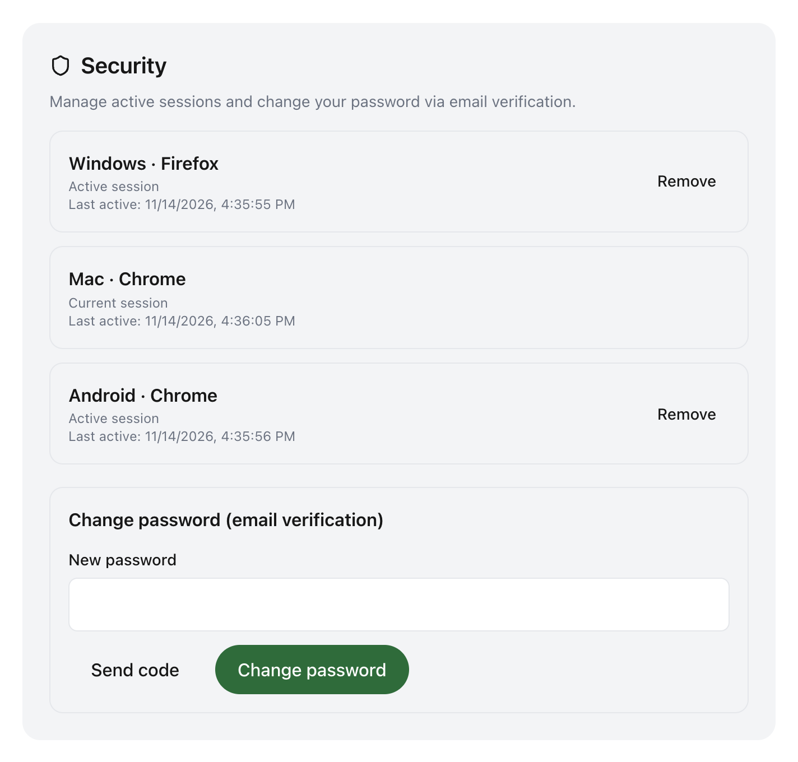
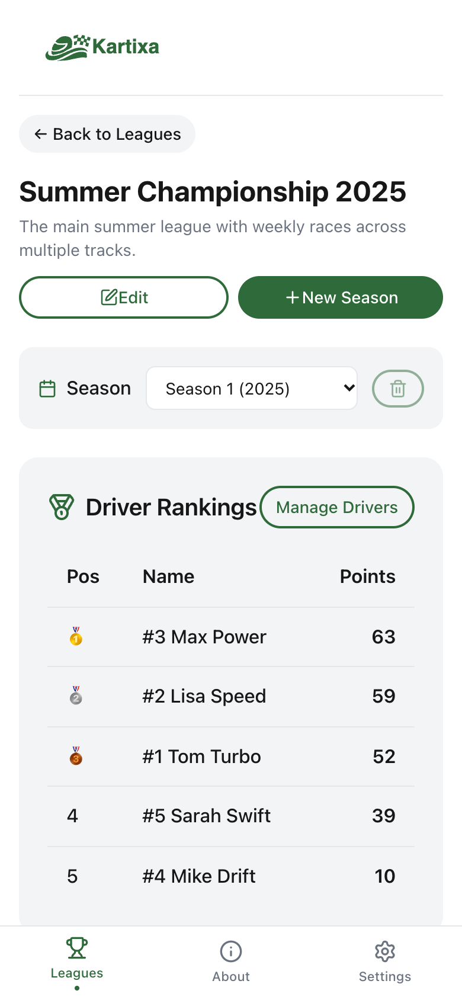

# Kartixa

**Go-Kart League & Race Tracker**

Kartixa is a web app for creating and managing Go-Kart leagues.
Drivers, races, and standings are displayed in a clear and organized way.



## Features

- Create and view leagues
- Driver rankings with point system
- Races with tracks and results
- Modern, responsive UI
- Email verification on account creation
- Email-based verification for new devices
- Active session list with session revocation
- Email-based password reset and password change

## Screenshots

<table>
  <tr>
    <td width="50%">
      
      <p align="center"><b>Leagues</b> — all your leagues at a glance, join others by invite code</p>
    </td>
    <td width="50%">
      
      <p align="center"><b>Race results</b> — positions, lap times, points, fastest lap and podium</p>
    </td>
  </tr>
  <tr>
    <td width="50%">
      
      <p align="center"><b>Drivers</b> — season stats per driver, with teams and numbers</p>
    </td>
    <td width="50%">
      
      <p align="center"><b>New race</b> — enter results, points are calculated automatically</p>
    </td>
  </tr>
  <tr>
    <td width="50%">
      
      <p align="center"><b>Security</b> — see and revoke active sessions, change password via email code</p>
    </td>
    <td width="50%" align="center">
      
      <p align="center"><b>Mobile</b> — responsive layout with bottom navigation</p>
    </td>
  </tr>
</table>

## Tech Stack

- **Framework:** Next.js 16 (App Router)
- **Language:** TypeScript
- **Database:** MariaDB 11 with Drizzle ORM
- **Auth:** NextAuth.js 5
- **Styling:** Tailwind CSS 4
- **Icons:** Lucide React

## Development

Requirements: Node.js and Docker.

```bash
# Install dependencies
npm install

# Configure environment
cp .env.example .env
echo "DATABASE_HOST=localhost" > .env.local   # .env.example targets the Docker network

# Start MariaDB (Docker) and wait until it is healthy (~30s)
npm run dev:db

# Create tables and load demo leagues, drivers and races
DATABASE_HOST=localhost npm run db:migrate
DATABASE_HOST=localhost npm run db:seed

# Start development server on http://localhost:3000
npm run dev
```

Register an account in the app. With `MAIL_ENABLED=false` (the default) no emails are
sent; verification codes are printed to the `npm run dev` terminal instead.

The seed data has no users, so to see the demo leagues, make your account a member:

```bash
docker exec -i kartixa-db mariadb -ukartixa -pkartixa_dev kartixa -e "
INSERT INTO league_memberships (id, league_id, user_id, role)
SELECT UUID(), l.id, u.id, 'owner' FROM leagues l CROSS JOIN users u
WHERE u.email = 'you@example.com';"
```

Other commands:

```bash
npm run build      # Create production build
npm run lint       # Run linting
npm run typecheck  # Type-check without emitting
```

## Auth Security Setup

Run migrations after pulling latest changes:

```bash
npm run db:migrate
```

Optional SMTP setup for real emails (otherwise codes are logged to server logs):

```bash
MAIL_ENABLED=true
MAIL_FROM="Kartixa <no-reply@kartixa.local>"
SMTP_HOST=localhost
SMTP_PORT=1025
SMTP_SECURE=false
SMTP_USER=
SMTP_PASSWORD=

AUTH_CHALLENGE_SECRET=your-long-random-secret
AUTH_EMAIL_CODE_TTL_MINUTES=10
AUTH_SESSION_TTL_DAYS=30

# Privacy-by-default auth metadata settings
AUTH_STORE_SESSION_IP_ADDRESS=false
AUTH_STORE_SESSION_USER_AGENT=true
AUTH_SESSION_METADATA_RETENTION_DAYS=90
AUTH_TRUSTED_DEVICE_RETENTION_DAYS=180
AUTH_CHALLENGE_RETENTION_DAYS=7
```

## License

This project is licensed under the MIT License - see the [LICENSE](LICENSE) file for details.

## Credits

- **Framework:** [Next.js](https://nextjs.org/) (MIT)
- **UI Runtime:** [React](https://react.dev/) / [React DOM](https://react.dev/) (MIT)
- **Auth:** [Auth.js / NextAuth.js](https://authjs.dev/) (ISC)
- **Database ORM:** [Drizzle ORM](https://orm.drizzle.team/) (Apache-2.0)
- **Database Driver:** [mysql2](https://github.com/sidorares/node-mysql2) (MIT)
- **Validation:** [Zod](https://zod.dev/) (MIT)
- **Password Hashing:** [bcryptjs](https://github.com/dcodeIO/bcrypt.js/) (MIT)
- **Mail Transport:** [Nodemailer](https://nodemailer.com/) (MIT)
- **I18n:** [next-intl](https://next-intl.dev/) (MIT)
- **Icons:** [Lucide React](https://lucide.dev/) (ISC) — Lizenzhinweis in [licenses/lucide.txt](licenses/lucide.txt)
- **Fonts:** [Geist](https://vercel.com/font) (SIL Open Font License)
